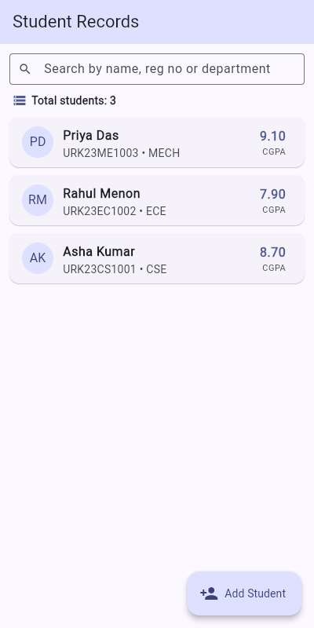
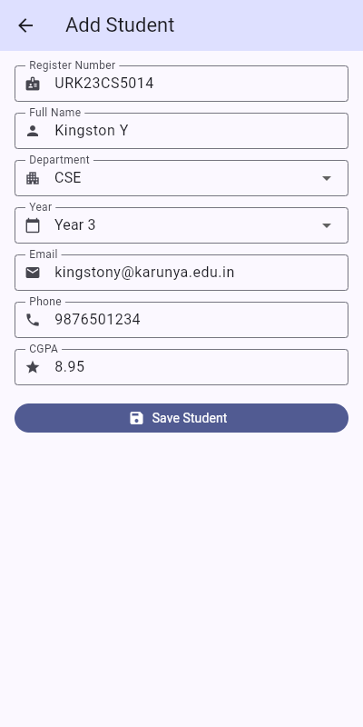
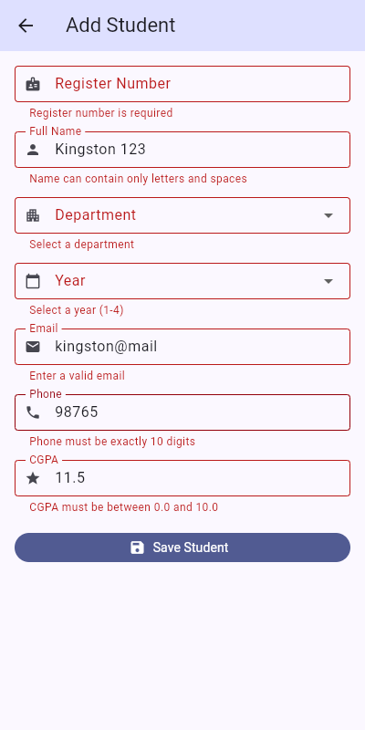
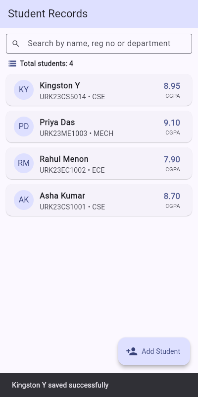
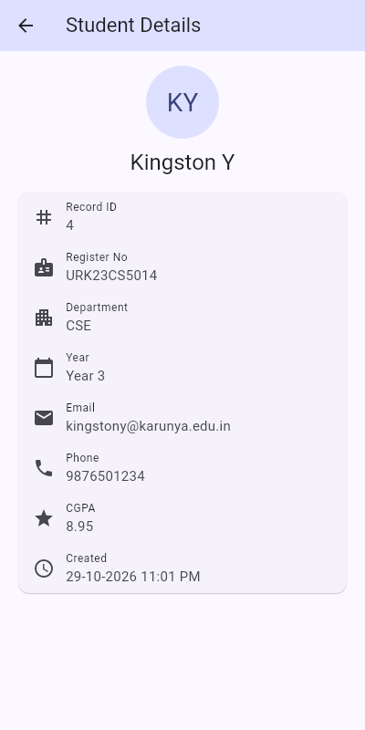
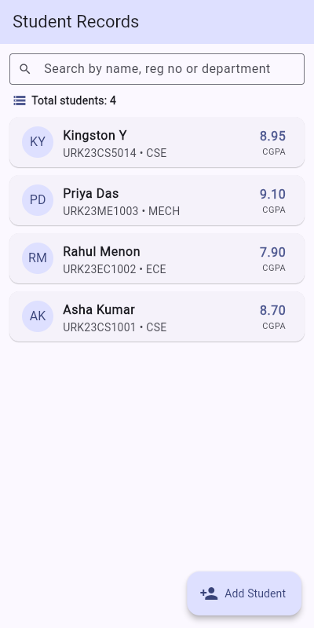

# Experiment 6 – Data Persistence using SQLite

**Course:** 24CS2016 – Building Applications using Flutter
**Register No:** URK23CS5014

## Aim
Design and develop a Flutter application that stores and retrieves student records
using the SQLite database by implementing Create and Read operations.

## Features
- SQLite database `students.db` with a `students` table (regNo is `UNIQUE`)
- **Create** – Add Student form with validation (reg no, name, department, year,
  email, 10-digit phone, CGPA 0–10); duplicate register numbers are rejected
- **Read** – list of all students (FutureBuilder, total count, search, pull-to-refresh)
  and a detail screen that reads one record by register number
- Parameterised queries (`whereArgs`) only
- Data persists across restarts; 3 sample students are inserted on first launch
- Runs on Android/iOS (sqflite), Windows/Linux/macOS (sqflite_common_ffi) and
  Web (sqflite_common_ffi_web, IndexedDB-backed)

## Project structure
```
lib/
  main.dart                          # database factory per platform + MaterialApp
  models/student.dart                # Student model with toMap()/fromMap()
  database/database_helper.dart      # singleton DatabaseHelper (CREATE + READ)
  screens/student_list_screen.dart
  screens/add_student_screen.dart
  screens/student_detail_screen.dart
  widgets/student_card.dart
  widgets/student_form_field.dart
  widgets/empty_state.dart
```

## How to run
```bash
flutter pub get
flutter run -d chrome      # web
flutter run -d windows     # desktop
flutter test               # DatabaseHelper unit tests + form widget tests
```
For the web build, `web/sqlite3.wasm` and `web/sqflite_sw.js` are already included
(generated with `dart run sqflite_common_ffi_web:setup`).

## Screenshots
| Student list | Add student form | Validation errors |
|---|---|---|
|  |  |  |

| Record saved | Student details | Data after reload |
|---|---|---|
|  |  |  |
